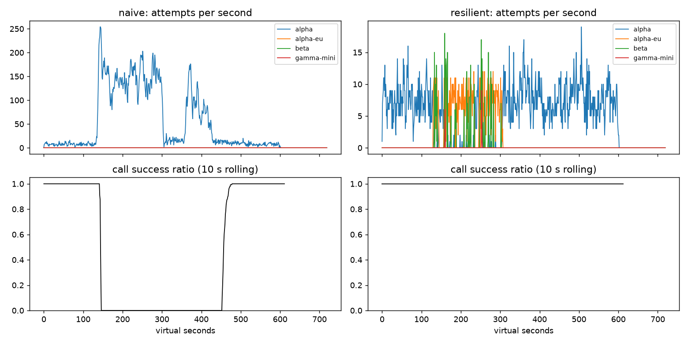

# Lab 25B — Report

**Họ tên / nhóm:** Lê Nguyễn Quốc Bảo (theo tên repo)

**Commit nền:** `18cc181`; code, cấu hình và báo cáo được nộp cùng commit `Complete Lab 25B reliability checkpoints and report`.

**Điểm tự động (`make grade`):** **84 / 88**; đạt toàn bộ 84 điểm public, 4 điểm SLO ẩn chưa được chấm. Report 12 điểm chấm tay chưa có kết quả.

Môi trường kiểm tra: Python 3.11, cài editable `pip install -e '.[dev,plot]'`; không cần key LLM. Số liệu dưới đây dùng seed 25, client RNG mặc định của factory là 1. `scoreboard_multiseed.json` xác nhận G1–G6, C1 và workflow PASS trên seed 25, 26, 27; không thay thế kiểm tra băng ẩn của giảng viên. Bộ test gốc: **82/82 PASS**, gồm 76 test tính điểm và 6 test simulator sanity.

Lệnh tái hiện (sau khi kích hoạt virtualenv):

```bash
make test
make compare
make workflows
make slo
make cache
python scripts/run_experiments.py
make plot
make grade
python scripts/grade.py --seeds 25,26,27 --out reports/scoreboard_multiseed.json
```

Dữ liệu thí nghiệm: [experiments.json](experiments.json); runner chỉ tạo cấu hình trong bộ nhớ và subclass thử nghiệm, không sửa client triển khai hay các băng gốc.

## 1. Kết quả Game Day (naive vs của bạn)

| Băng | Client | availability | p95 (s) | amplification | retry_ratio | cost/turn | recovery (s) | PASS? |
|---|---|---|---|---|---|---|---|---|
| G1 | naive | 0.7194 | 7.157 | 7.738 | 6.738 | 2.163 | 4.0 | FAIL |
| G1 | yours | 1.0 | 4.817 | 1.06 | 0.001 | 2.094 | 0.0 | PASS |
| G2 | naive | 0.456 | 15.034 | 9.904 | 8.904 | 4.627 | 155.0 | FAIL |
| G2 | yours | 1.0 | 10.023 | 1.035 | 0.005 | 2.107 | 0.0 | PASS |
| G3 | naive | 1.0 | 4.768 | 1.164 | 0.164 | 2.328 | 0.0 | FAIL |
| G3 | yours | 1.0 | 4.642 | 1.076 | 0.049 | 2.167 | 0.0 | PASS |
| G4 | naive | 1.0 | 13.764 | 1.004 | 0.004 | 2.008 | 0.0 | FAIL |
| G4 | yours | 1.0 | 5.626 | 1.014 | 0.002 | 2.072 | 0.0 | PASS |
| G5 | naive | 0.3699 | 5.359 | 17.03 | 16.03 | 2.124 | — | FAIL |
| G5 | yours | 0.8179 | 5.482 | 1.003 | 0.002 | 2.504 | — | PASS |
| G6 | naive | 0.517 | 4.836 | 12.344 | 11.344 | 2.009 | 0.0 | FAIL |
| G6 | yours | 1.0 | 6.096 | 1.059 | 0.023 | 2.188 | 0.0 | PASS |

Nguồn: [naive.json](gameday/naive.json), [resilient.json](gameday/resilient.json). Availability là tỷ lệ lượt user; recovery tính trên tỷ lệ **logical call** thành công trong cửa sổ 30 giây. `recovery=0` nghĩa là dịch vụ vẫn đạt tiêu chí ngay sau restore nhờ fallback, không có nghĩa alpha đã đóng breaker tại đúng thời điểm đó. G5 không định nghĩa restore nên recovery là `null`. G1 có 0 vi phạm retry-after; G5 có 0 retry lỗi client và 0 failover không cần thiết; G6 có 0 incompatible route. Primary share sau restore: G1 93,5%, G2/G3/G4/G6 đều 100%.

## 2. Cấu hình client và lý do

Giữ nguyên khối client của starter vì triển khai đúng đã PASS 6/6 băng trên cả ba seed; chỉ tinh chỉnh khối cache. Không có logic dựa trên tên băng, thời điểm sự cố, hoặc state riêng của simulator.

| Tham số | Giá trị | Vì sao (dựa trên băng nào, số liệu nào) |
|---|---:|---|
| attempt_timeout_s | 8 | G6 availability 100%; tăng lên 30 làm giảm còn 94,88% vì hết deadline trước fallback |
| max_attempts_per_provider | 2 | Một retry, một tầng; G2 amplification 1,035 so với naive 9,904; thí nghiệm 5 attempts khi breaker sai/budget tắt đạt 1,602 |
| min_time_left_s | 1 | Không tạo attempt vô nghĩa sát deadline 30s; unit test kiểm tra không gửi vượt deadline; G6 100% thành công |
| backoff_base_s / cap_s | 0,25 / 4 | Full jitter để phân tán retry; G1 0 retry-after violations, amplification 1,060; cap giới hạn thời gian chờ trong deadline |
| retry_budget_ratio | 0,1 | G3 retry ratio 0,049 ≤0,10; khi breaker sai, budget giữ ratio 0,068 thay vì 0,163 |
| retry_budget_min_per_s / max_tokens | 0,5 / 20 | Cho phép burst nhỏ và retry khi traffic thấp; G2 ratio 0,005. Ratio 0,1 không phải trần tuyệt đối vì còn token ban đầu và refill theo thời gian |
| quota_cooldown_s | 300 | Không thử lại liên tục account hết tiền; G5 amplification 1,003, availability 81,79% dù request malformed không cứu được |
| breaker.window_size / min_calls | 20 / 10 | Cửa sổ hữu hạn quên lịch sử cũ; G2 recovery 0s, primary share 100%; tránh trip chỉ vì 1–2 lỗi |
| breaker.failure_rate_threshold | 0,5 | G2 ngắt tải khi lỗi tích tụ, amplification 1,035; G3 còn retry ít, availability 100% |
| breaker.slow_call_s / slow_rate_threshold | 5 / 0,6 | Bắt cả thành công chậm: G4 p95 giảm 13,764 → 5,626s mà availability vẫn 100% |
| breaker.open_duration_s | 10 | Cho hàng đợi thoát tải rồi probe; G2 recovery 0s và primary share 100%, không bám fallback lâu sau restore |
| breaker.half_open_max_probes / successes | 2 / 2 | Giới hạn 2 probe đang bay, cần 2 thành công nhanh; 13/13 breaker tests PASS, gồm 50 request đồng thời và bỏ kết quả generation cũ |

Các kết quả trên chứng minh cấu hình tổng thể; không coi mỗi tham số là nguyên nhân độc lập nếu chưa có ablation riêng.

Sơ đồ quyết định `on_error`:

| Loại lỗi | Ghi breaker? | Retry cùng provider? | Failover? | Cooldown? |
|---|---|---|---|---|
| CLIENT_ERROR (400/401/…) | Release permit, không ghi health | Không | Không, GiveUp | Không |
| QUOTA_EXHAUSTED (429) | Release | Không | Ngay | 300s, dùng max với cooldown hiện có |
| RATE_LIMITED (429) | Release | Chọn spillover trước | Ngay | Ít nhất retry-after; thiếu header dùng 1s |
| OVERLOADED / SERVER_ERROR / TIMEOUT | on_failure | Nếu còn attempts, breaker không OPEN, budget có token và đủ deadline; full jitter | Khi không retry được | Không cooldown riêng |

Routing bỏ qua provider thiếu capability, đang cooldown hoặc breaker từ chối. Khi hết ladder, chỉ chờ cooldown ngắn ≤5s và breaker không OPEN, cộng jitter; timeout luôn bị chặn bởi deadline. Callback cancel giải phóng probe. Success chậm cũng được báo breaker; generation ngăn kết quả cũ làm hỏng state mới.

## 3. Ba thí nghiệm (mỗi cái 3–5 câu + số)

**1. Retry budget là lớp phòng thủ cuối.** Đặt `breaker.min_calls=1000000000`, `max_attempts_per_provider=5`; bảng dưới dùng đúng hai cấu hình budget trong template.

| Băng | Budget | availability | amplification | retry_ratio | recovery (s) |
|---|---|---|---|---|---|
| G2 | budget_on | 0.9992 | 1.38 | 0.058 | 0.0 |
| G3 | budget_on | 1.0 | 1.136 | 0.068 | 0.0 |
| G2 | budget_off | 0.9704 | 1.602 | 0.397 | 29.0 |
| G3 | budget_off | 1.0 | 1.164 | 0.163 | 0.0 |

Ở G2, budget giảm amplification 1,602 → 1,380 và recovery 29 → 0s dù breaker không mở được. G3 giảm retry ratio 0,163 → 0,068, cho thấy budget bảo vệ khi lỗi rải rác chưa đủ trip. Khi breaker hoạt động đúng, tắt budget cho G2 vẫn ra amplification 1,035 và retry ratio 0,005; G3 cho ratio 0,042 so với 0,049 khi bật, nên không thể khẳng định tắt budget luôn làm xấu mọi số đo trên một seed (routing làm đổi chuỗi sự kiện/ngẫu nhiên). Vẫn cần cả hai: breaker cô lập provider theo health, budget chặn khuếch đại khi breaker bị cấu hình sai hoặc chưa đủ mẫu.

**2. `attempt_timeout_s: 30`.**

| Băng | timeout 8: availability / p95 | timeout 30: availability / p95 |
|---|---|---|
| G4 | 1,0000 / 5,626s | 1,0000 / 5,608s |
| G6 | 1,0000 / 6,096s | 0,9488 / 5,463s |

G4 vẫn được slow-call breaker bảo vệ nên tăng timeout không làm p95 xấu lên đáng kể. G6 tụt xuống dưới ngưỡng 95% vì provider treo chiếm hết thời gian cho cả lượt. p95 ở G6 lại thấp hơn vì metric chỉ tính **lượt thành công**, bỏ các lượt timeout ra khỏi mẫu; phải xem cùng availability. Timeout nên dựa trên phân bố độ trễ khỏe của provider và phần deadline cần dành cho tool, chat, backoff, fallback, thay vì lấy toàn bộ 30s cho mỗi attempt.

**3. Bỏ lọc tool calling khỏi `ladder()`.** Subclass thử nghiệm trả toàn bộ fallback order trên G6 tạo **230 incompatible routes**, availability giảm 100% → **90,36%**, cost/good turn tăng 2,188 → **2,290**. Với product manager, đây là 230 lần hệ thống chuyển yêu cầu cần thao tác công cụ tới model không có khả năng thực hiện, chứ không phải một lựa chọn model rẻ tương đương. Provider rẻ không thay thế được capability còn thiếu; bản triển khai giữ bộ lọc và đạt 0 route sai.

## 4. Workflow hoàn tiền

| Executor | completion | crashes | duplicate refunds | duplicate emails | lost refunds | overpaid (cents) | wasted LLM / crash |
|---|---|---|---|---|---|---|---|
| naive | 1.0 | 81 | 128 | 81 | 0 | 1574200 | 1.123 |
| yours | 1.0 | 66 | 0 | 0 | 0 | 0 | 0.303 |

Nguồn: [workflows.json](workflows.json). Cả hai chạy 500 phiên; số crash khác nhau vì đường chạy/retry khác nhau. Bản mới ghi 2.500 checkpoint, thực thi đúng 500 refund và lãng phí 20 LLM call.

Idempotency key ổn định theo `(session, step)` giúp payment/email nhận lại cùng key sau lost response hoặc worker crash và trả kết quả cũ, không tạo side effect lần hai. Chỉ key chưa đủ vì worker vẫn có thể làm lại classify/lookup/summary và tốn LLM; checkpoint giữ kết quả mỗi bước để resume. Chỉ checkpoint chưa đủ vì có khoảng trống sau khi tiền đã đi nhưng trước khi lưu kết quả, lần chạy lại vẫn có thể hoàn tiền trùng. Nếu ghi checkpoint **trước** payment, crash giữa hai thao tác khiến resume bỏ qua khoản chưa thực hiện và mất hoàn tiền. Executor chỉ bắt ServiceError/ServiceTimeout, không bắt WorkerCrash; bảo đảm exactly-once effect dựa vào dịch vụ deduplicate và DurableStore tồn tại qua restart như contract của lab.

## 5. Alerting & error budget

| Sự cố | Mong đợi | Naive alerter | Burn-rate alerter | Độ trễ burn-rate (phút) |
|---|---|---|---|---|
| checkout_bug | page | phát hiện (1m) | phát hiện (27m) | 27 |
| provider_outage | page | phát hiện (0m) | phát hiện (4m) | 4 |
| deploy_blip | none | page sai | không page | — |
| slow_leak | ticket | bỏ sót | phát hiện (1337m) | 1337 |
| degraded_evening | page | phát hiện (214m) | phát hiện (291m) | 291 |
| night_spike | none | page sai | không page | — |
| small_bump | none | page sai | không page | — |

Nguồn: [slo.json](slo.json). Naive: 7 page, 0 ticket, 3 false page; burn-rate: **3 page, 1 ticket, 0 false page**. Prefix sum xây O(n), mỗi truy vấn O(1); scan cả ba rule O(n × số rule). Hai cửa sổ phải cùng vượt ngưỡng: 14,4× (60/5 phút), 6× (360/30 phút), 1× (4.320/360 phút).

30 ngày có **25.901.755 requests**, budget = 0,005 × requests = **129.508,8** lỗi được phép, thực tế **55.618** lỗi. Availability = **99,7853%**, budget đã tiêu **42,95%**, còn **57,05%**; **không freeze release** theo quy tắc budget chưa cạn. `small_bump` 20 phút ở 12% lỗi có burn tức thời 24×, nhưng trung bình một giờ ở lưu lượng đều chỉ khoảng 8×, chưa đạt 14,4×; cửa sổ 6h khoảng 1,33×, chưa đạt 6× (dữ liệu thực dùng tổng request có trọng số). Đây là lý do không đánh thức on-call lúc 11 giờ trưa bằng ngưỡng 5 phút đơn lẻ; số thực nghiệm xác nhận 0 page cho sự kiện này.

## 6. Postmortem — Băng G2 với client naive (blameless)



**Tóm tắt (3 câu):** Khi alpha mất 75% GPU từ t=120 đến t=300, retry ba tầng khuếch đại thành 34.475 attempts cho 3.481 logical calls (9,904×). Có 1.285/2.362 lượt user thất bại, availability chỉ 45,60%, trong khi client resilient đạt 100%. Dịch vụ naive chỉ đạt lại tỷ lệ call thành công ≥95% trong cửa sổ 30s bắt đầu t=455, tức 155s sau provider restore.

**Ảnh hưởng:** 1.285 lượt thất bại; khoảng từ trigger đến cửa sổ phục hồi là 335s (120→455), không khẳng định mọi giây trong khoảng đều có 0 thành công. Các cửa sổ 150–180, 270–300, 300–330 và 420–450 đều 0% call thành công; p95 của lượt thành công toàn băng là 15,034s. Với giả định tháng 30 ngày đều **4 lượt user/s**, chỉ có sự cố này, còn lại tất cả thành công, budget tháng 99,5% = 4 × 30 × 86.400 × 0,005 = **51.840 lượt lỗi**; sự cố tiêu **2,48%** budget tháng, **không vượt** toàn bộ budget (còn 97,52%). Nếu chỉ lấy traffic của băng làm mẫu thì 54,4% lỗi / 0,5% = 108,8× budget tương ứng với mẫu đó; đây không phải budget tháng và không được nhầm hai mẫu số.

**Timeline** (giây ảo; tổng hợp CSV theo cửa sổ [t, t+30), attempts/s là trung bình trong cửa sổ):

| t / cửa sổ | Sự kiện | Bằng chứng từ CSV |
|---|---|---|
| 90–120 | Trước sự cố | 238 attempts /30s = 7,93/s; 234/234 call thành công = 100% |
| 120–150 | alpha mất 75% năng lực; retry bắt đầu tăng | 2.723 attempts = 90,77/s; 51/98 call thành công = 52,04% |
| 150–180 | Storm đã hình thành | 4.220 attempts = 140,67/s; 0/124 = 0% |
| 270–300 | Trước provider restore | 4.674 attempts = 155,80/s; 0/127 = 0% |
| 300–330 | Provider đã hồi phục, dịch vụ vẫn thất bại | 703 attempts = 23,43/s; 0/55 = 0% |
| 420–450 | Retry vẫn duy trì backlog | 646 attempts = 21,53/s; 0/108 = 0% |
| 455–485 | Cửa sổ đầu đạt recovery criterion | 326 attempts = 10,87/s; 352/368 = 95,65% |
| 480–510 | Ổn định lại | 313 attempts = 10,43/s; 325/325 = 100% |

Nguồn: [CSV naive G2](gameday/naive_G2_overload_storm_timeseries.csv). Đây là số call hoàn tất và attempt bắt đầu trong từng cửa sổ, khác cohort nên không chia calls_ok cho attempts để tính success ratio.

**Trigger vs root cause:** Trigger là alpha mất 75% GPU trong 180s. Root cause thuộc kiến trúc: app × gateway × SDK cho tối đa 36 attempts/call, delay cố định, không jitter, không budget, không breaker và không fallback. Timeout của client không hủy công việc ở server: request bị bỏ vẫn chiếm slot, request mới chờ lâu rồi timeout, và timeout lại tạo retry; đó là vòng phản hồi giữ hệ thống trong metastable failure. Sau t=300, alpha có khoảng 18/1,2 ≈15 request/s công suất danh nghĩa (chưa tính phân bố thời gian phục vụ), trong khi attempts còn 23,43/s và 21,53/s ở các cửa sổ sau restore; backlog chưa thoát được, dù không phải mọi attempt đều được nhận vào hàng đợi.

**Điều gì giúp / điều gì làm tệ hơn:** CSV và replay có seed giúp tách rõ trigger khỏi thời gian phục hồi; fallback và breaker của bản mới giữ availability 100%, amplification 1,035. Bản naive gặp 2.737 timeout, 3.194 overloaded error, 26.298 rate-limit error và 28.381 retry-after violations; retry liên tục đã làm tăng tải mà không tăng lượt thành công. Các giá trị mặc định ở nhiều tầng được ghép mà chưa có một ngân sách retry chung hay kiểm tra lỗi dưới tải; cải tiến tập trung vào giao diện và quy trình này, không quy trách nhiệm cho cá nhân vận hành.

**Action items:**

| # | Hành động | Loại | Owner (vai trò) | Cách kiểm chứng |
|---|---|---|---|---|
| 1 | Chỉ một tầng retry, budget và full jitter; tắt retry SDK/gateway khi tích hợp thật | prevent | Agent platform maintainer | CI G2 amplification ≤1,2, G3 retry ratio ≤0,10; chạy ablation breaker sai |
| 2 | Đưa multiwindow burn-rate và amplification/provider timeout lên dashboard | detect | SRE on-call | Replay SLO public: 0 false page, đủ 3 major incidents; G2 báo amplification vượt 1,6 |
| 3 | Triển khai breaker có slow-call, probe giới hạn và fallback có capability | mitigate | Reliability maintainer | G2 recovery ≤30s, primary share ≥80%; G4 p95 ≤10s; G6 0 incompatible routes |
| 4 | Bắt buộc replay nhiều seed trước release và lưu artifacts | prevent | CI maintainer | `grade.py --seeds 25,26,27` PASS mọi check G1–G6/C1, không chỉnh tests/scenarios |

Đây là owner theo vai trò đề xuất trong lab, chưa phải giao việc cho người thật.

## 7. Một điểm yếu còn lại

G2 vẫn có p95 **10,023s**, cao hơn G1 **4,817s**, dù không mất lượt user: những request đang bay trước khi breaker đủ mẫu vẫn chịu hàng đợi và timeout. Nếu cả bốn provider cùng chậm/hết năng lực thì fallback không tạo thêm capacity; C1 minh họa availability tổng chỉ **91,24%** dù FAQ đạt 96,45%. Hướng cải tiến là giới hạn concurrency theo provider và admission control theo deadline, đồng thời dành capacity cho tool và đo p95/p99 cả lượt thất bại; cần ablation mới trước khi khẳng định cải thiện. Chi phí cũng tăng khi chuyển sang beta: G5 cost/good turn **2,504**, vì vậy phải theo dõi cost cùng availability.

## 8. Cache (Part G)

| Client | availability | faq_availability | cache_hit_ratio | stale_served | wrong_answers | outdated_answers | cost/turn | PASS? |
|---|---|---|---|---|---|---|---|---|
| resilient | 0.8373 | 0.8424 | 0.0 | 0 | 0 | 0 | 1.386 | FAIL |
| cached | 0.9124 | 0.9645 | 0.652 | 157 | 0 | 3 | 0.915 | PASS |

Nguồn: [resilient](cache/resilient.json), [cached](cache/cached.json). Bản không cache được đánh giá cùng checks C1 để có đối chứng. `cache_hit_ratio` chia cho số lượt FAQ, gồm personal; không phải tỷ lệ của mọi lượt trong hệ thống.

| Tham số `cache:` | Giá trị | Vì sao (số liệu nào) |
|---|---:|---|
| similarity_threshold | 0,90 | 0 wrong answer, reason map `{}`; ngưỡng 0,80 tạo 157 lỗi other_question khi giữ TTL/stale như bản cuối |
| ttl_s | 60 | 3 outdated answers ≤15; 300s tạo 95 outdated, còn 30s giảm xuống 2 nhưng hit giảm 65,2%→59,2% |
| max_stale_s | 600 | 157 stale được phục vụ; FAQ availability 96,45% so với 87,33% khi tắt stale |
| max_entries | 500 | Giới hạn bộ nhớ bằng LRU; cấu hình này đạt hit 65,2%, unit test capacity=2 xác nhận loại entry ít dùng nhất; chưa khẳng định 500 là tối ưu |

Scope theo prompt_version; personal bị chặn ở cả lookup/store; webhook invalidate theo source; stale lookup lại tại lúc GiveUp để không dùng kết quả đã bị invalidate trong thời gian chờ provider.

**1. Ngưỡng** (giữ TTL=60, stale=600):

| Ngưỡng | Hit ratio | Wrong answers | Reason | Cost/good turn |
|---|---|---|---|---|
| 0.8 | 0.666 | 157 | {'other_question': 157} | 0.965 |
| 0.9 | 0.652 | 0 | {} | 0.915 |
| 0.97 | 0.581 | 0 | {} | 0.964 |

0,80 gộp cả các câu gần về từ ngữ nhưng khác ý, như điều kiện hoàn tiền với thời gian nhận tiền, đổi size với đổi màu, phí ship nội thành với ngoại tỉnh; các cặp này được xác định từ catalog của repo, còn metric tổng chỉ xác nhận 157 `other_question`, không phân rã số lỗi theo từng cặp. 0,90 loại được toàn bộ lỗi trên băng này; 0,97 cũng đúng nhưng bỏ nhiều paraphrase, hit giảm 65,2%→58,1% và cost tăng 0,915→0,964. Đây là lý do chọn 0,90 dựa trên đo lường, không xem cosine là bảo đảm ngữ nghĩa cho mọi embedding thật.

**2. TTL** (ngưỡng=0,90, stale=600):

| TTL (s) | Hit ratio | Outdated | FAQ availability | Cost/good turn |
|---|---|---|---|---|
| 30 | 0.592 | 2 | 0.9645 | 0.955 |
| 60 | 0.652 | 3 | 0.9645 | 0.915 |
| 300 | 0.731 | 95 | 0.964 | 0.863 |

Webhook ở t=150 loại các câu dựa trên chính sách hoàn tiền đã đổi, nhưng cập nhật phí ship t=480 là **silent**, nên client không có sự kiện để invalidate. Khi provider khỏe, TTL buộc refresh và là cơ chế giới hạn độ cũ của thay đổi không được báo trong mô hình này; TTL 300 để 95 câu lỗi thời còn TTL 60 chỉ 3. Nếu provider cũng sập, stale-if-error có thể kéo dài độ cũ đến TTL + max_stale_s, nên không được tuyên bố TTL một mình luôn là trần tuyệt đối khi stale đang bật.

**3. Stale-if-error.** Tắt `max_stale_s` từ 600 xuống 0 làm stale_served từ **157 xuống 0**, FAQ availability từ **96,45% xuống 87,33%** (giảm 9,12 điểm phần trăm), hit từ 65,2% xuống 56,1%. Với stale=600, entry cũ chỉ phục vụ khi inner client GiveUp; lúc provider khỏe vẫn refresh sau TTL. Starter đồng thời dùng threshold=0,80 / TTL=600 / stale=0 cho 181 wrong, 80 outdated và FAQ 85,87%; không nhầm kết quả nhiều biến này với các ablation một biến ở trên.

**Câu hỏi cá nhân:** Cache theo user chỉ giảm nguy cơ lộ chéo tài khoản, không đảm bảo câu trả lời còn đúng sau trạng thái đơn/hoàn tiền/điểm thay đổi. Lab không có giao thức invalidation theo từng tài khoản hoặc authorization snapshot; cùng user vẫn có thể nhận sai trạng thái ảnh hưởng quyết định tài chính. Vì vậy personal nằm ngoài allowlist, không lưu và không phục vụ cả fresh lẫn stale.

**Alert khi dashboard còn xanh nhờ stale:** Tách SLI câu trả lời FAQ khỏi health upstream; theo dõi lỗi/timeout của các attempt thật, số provider OPEN, số GiveUp trước stale fallback, stale_served rate và tuổi câu stale. C1 có **157 stale** và FAQ 96,45% trong khi đối chứng không cache chỉ 84,24%: dashboard user availability không đủ phát hiện provider outage. Đề xuất alert khi tất cả provider không khả dụng hoặc stale rate kéo dài kèm lỗi upstream, với probe có giới hạn ngay cả khi ít cache miss; dùng burn-rate cho tác động user để tránh vừa bỏ sót upstream vừa page theo mọi lỗi thoáng qua. Đây là đề xuất vận hành, chưa phải một rule bổ sung đã được chấm trong phần E.
